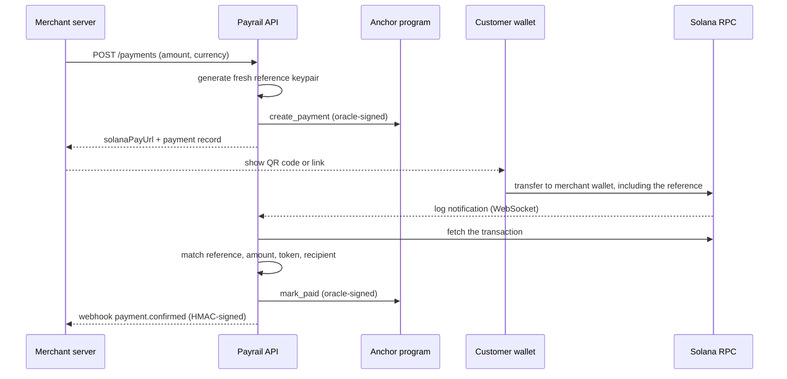
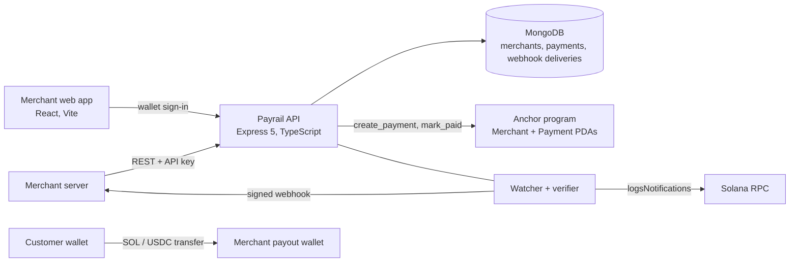

# Payrail

**A non-custodial payment gateway for Solana merchants.**
Customers pay the merchant's wallet directly. Payrail tags every order, verifies the payment on-chain, records it on Solana, and notifies the merchant with a signed webhook.

<!-- Add a demo video or GIF here -->

> Built as the final project for the Solana School Fall 2026 cohort's Demo Day. It is a working prototype and a portfolio piece, not production payments infrastructure. See [Scope and known limitations](#scope-and-known-limitations) for an honest list of what it does not do.

**Contents:** [The problem](#the-problem) · [What Payrail does](#what-payrail-does) · [How it works](#how-it-works) · [Core concepts](#core-concepts) · [Architecture](#architecture) · [On-chain program](#on-chain-program) · [Getting started](#getting-started) · [Using the API](#using-the-api-step-by-step) · [API reference](#api-reference) · [Webhooks](#webhooks) · [Security design](#security-design) · [Upcoming](#upcoming) · [Scope and known limitations](#scope-and-known-limitations)

---

## The problem

Accepting crypto payments sounds simple: the customer sends money to your wallet. In practice, three things get in the way.

1. **A transfer is not an order.** Two customers can send exactly 0.05 SOL to the same wallet. The chain only records "someone paid 0.05 SOL", not which order each payment belongs to.
2. **The plumbing is hard to get right.** A merchant has to watch the chain, check the amount, token and recipient of each transaction, survive dropped connections, and notify their own server. Each of these is a place for bugs.
3. **Custodial gateways hold the money.** Traditional processors sit between buyer and merchant, take custody of the funds, and pay out later.

## What Payrail does

Payrail is the layer in the middle. A merchant registers once and then creates payment requests through a REST API. For each request Payrail returns a [Solana Pay](https://docs.solanapay.com/) URL to show as a QR code or link.

- **Funds never touch Payrail.** The customer's wallet sends SOL or USDC straight to the merchant's payout wallet.
- **Every order gets a unique reference key**, so identical payments can still be told apart.
- **Payrail verifies, records and notifies.** It watches the chain, checks that reference, amount, token and recipient all match, writes the result to an on-chain Payment account, and sends the merchant a signed `payment.confirmed` webhook.
- **It recovers from outages.** If the server was offline when a payment landed, a recovery sweep finds it afterwards.

## Highlights

- Non-custodial: buyer → merchant, directly
- Solana Pay payment requests with one-time reference keys
- Live detection over WebSocket, plus a recovery sweep for missed events
- Four-field verification: reference, amount, token, recipient
- On-chain merchant registry and per-payment records (Anchor program)
- HMAC-SHA256 signed webhooks with automatic retries
- Wallet-based sign-in using single-use signed challenges
- React merchant app with wallet connect and on-chain registration (a merchant dashboard is upcoming)

## How it works



1. **Onboard.** The merchant connects a wallet and signs an `initialize` transaction that creates their on-chain Merchant account. They then register with the backend, which checks that this account exists and returns an API key, API secret and webhook secret (shown once).
2. **Create.** The merchant's server calls `POST /api/v1/payments`.
3. **Record.** Payrail generates a fresh reference keypair, builds the Solana Pay URL, creates a Payment PDA on-chain, and saves the pending payment in MongoDB. The request is valid for 15 minutes.
4. **Pay.** The customer scans the QR code or opens the link in a Solana Pay compatible wallet and approves the transfer. SOL or USDC goes directly to the merchant.
5. **Verify.** A per-merchant WebSocket subscription sees the transaction. Payrail fetches it and checks reference, amount, token and recipient.
6. **Confirm and notify.** The payment is marked confirmed, the Payment PDA is marked paid on-chain, and a signed webhook is sent to the merchant.

## Core concepts

### The reference key

For every payment request, Payrail generates a **fresh keypair and uses only its public key** as the reference. The reference is added to the Solana Pay transfer as a read-only, non-signer account. It never receives funds and never signs anything. Its only job is to tag the transaction, so that two orders with the same amount and the same recipient still produce different, matchable transactions.

### Four-field verification

A payment is confirmed only when the observed transaction matches the pending order on all four fields:

| Field | Meaning |
| --- | --- |
| **Reference** | Order identity: the fresh public key for this order |
| **Amount** | The exact quantity, compared in base units |
| **Token** | SOL, or the configured USDC mint |
| **Recipient** | The merchant's payout wallet |

An event on the chain is not proof of payment by itself. Only a full match confirms it.

### Payment lifecycle

`pending` → `confirmed`, `failed` or `expired`. A request expires 15 minutes after creation.

### Live detection and recovery

Payrail holds one `logsNotifications` WebSocket subscription per merchant payout wallet, with automatic reconnect. WebSocket events are transient, so on startup and on every re-subscription Payrail also runs a **recovery sweep**: it inspects the most recent 50 transactions for the merchant's wallet and runs them through the same verifier used for live detection.

## Architecture



Two paths run side by side:

- **Funds path:** customer wallet → merchant payout wallet. Direct, no custody.
- **Evidence path:** watcher → verifier → Payment PDA + MongoDB → webhook.

## On-chain program

`merchant_registry` is an Anchor program deployed on devnet at
`8v5vhk23UWumv3ReypP8hetreRsLFMcACDhrn2mZb38b`.

| Instruction | Signer | What it does |
| --- | --- | --- |
| `initialize` | Merchant wallet | Creates the Merchant PDA, seeded by the payout wallet |
| `update` | Merchant wallet | Toggles the merchant's active flag |
| `create_payment` | Payrail oracle | Creates a Payment PDA (seeded by merchant and reference hash) holding amount and mint |
| `mark_paid` | Payrail oracle | Marks a payment as paid |

The oracle's public key is hard-coded in the program as `ORACLE_AUTHORITY`, and the backend refuses to start if the loaded keypair does not match it. The TypeScript client is generated from the program's IDL with [Codama](https://github.com/codama-idl/codama).

## Tech stack

| Layer | Technology |
| --- | --- |
| Program | Rust 1.89, Anchor 1.x |
| Client generation | Codama |
| Backend | Node.js, Express 5, TypeScript, MongoDB (Mongoose), Zod, `@solana/kit`, `@solana/pay`, pino |
| Frontend | React 19, Vite, `@solana/kit`, wallet-standard |

## Repository layout

```
programs/merchant-registry/   Anchor program (Rust)
  src/instructions/           initialize, update, initialize_payment, mark_paid
  src/state/                  Merchant and Payment accounts
backend/                      API, watcher and verifier
  src/controllers, routes/    HTTP layer
  src/services/               auth, payments, Solana verification, webhooks
  src/watcher/                per-merchant subscription manager
  src/onchain/                typed wrappers over the generated client
  src/models/                 Mongoose models
app/                          React merchant app (landing, registration; dashboard upcoming)
tests/                        Anchor program tests (run against devnet)
codama.json                   Codama config for client generation
```

## Getting started

### Prerequisites

- Node.js 20+ and npm
- A MongoDB instance (local or Atlas)
- A Solana **devnet** RPC endpoint with a WebSocket URL. A provider such as Helius or QuickNode is recommended, because the public devnet endpoint rate-limits.
- A funded devnet keypair for the **oracle**. It must match `ORACLE_AUTHORITY` in the program, and it pays fees and rent for each payment record.
- Rust, the Solana CLI and Anchor, only if you want to rebuild or redeploy the program

### Install

```bash
git clone https://github.com/swastikkakran/solana-payrail.git
cd solana-payrail
npm install
(cd backend && npm install)
(cd app && npm install)
```

### Configure the backend

Create `backend/.env`:

```bash
MONGO_URI=mongodb://localhost:27017/payrail
SOLANA_RPC_URL=https://<your-devnet-rpc>
SOLANA_RPC_WSS_URL=wss://<your-devnet-rpc>
USDC_MINT_ADDRESS=<usdc mint to accept>
ORACLE_KEYPAIR_PATH=/path/to/oracle-keypair.json
ENCRYPTION_MASTER_KEY=<64 hex characters>   # openssl rand -hex 32
PAYRAIL_APP_URL=http://localhost:5173
PORT=3000
```

| Variable | Description |
| --- | --- |
| `MONGO_URI` | MongoDB connection string |
| `SOLANA_RPC_URL` / `SOLANA_RPC_WSS_URL` | Devnet HTTP and WebSocket endpoints |
| `USDC_MINT_ADDRESS` | The USDC mint Payrail accepts |
| `ORACLE_KEYPAIR_PATH` | Path to the oracle keypair JSON file |
| `ENCRYPTION_MASTER_KEY` | 32-byte key as 64 hex characters; encrypts webhook secrets |
| `PAYRAIL_APP_URL` | The single allowed CORS origin (default `http://localhost:5173`) |
| `PORT` | API port (default `3000`) |
| `LOG_LEVEL` | Optional pino log level |

### Run

```bash
# API and watcher  ->  http://localhost:3000
cd backend && npm run dev

# merchant app  ->  http://localhost:5173
cd app && npm run dev
```

### Demo mode

The merchant app can run entirely in the browser, with a simulated wallet, Solana network and Payrail API. Nothing leaves the page, so it works with no backend, wallet or RPC. It also shows a **preview of the upcoming dashboard** using sample data.

- Add `?demo` to the app URL to switch it on for the tab, or `?demo=off` to switch it off.
- Build with `VITE_DEMO=always` to lock the app into demo mode.

### Rebuild the program and client

```bash
anchor build        # builds the program and IDL
npm run codegen     # regenerates the TypeScript client from the IDL
```

### Tests

```bash
npm test
```

Runs the Anchor program tests with ts-mocha against **devnet**, using the wallet from `Anchor.toml` and the keypairs in `tests/fixtures/`. The tests cover creating a merchant, toggling its active state, creating a payment, marking it paid, and rejecting `mark_paid` from an unauthorized signer.

## Using the API: step by step

This walkthrough takes a merchant from zero to a confirmed payment. Examples use `curl` and Node.js, and assume the API runs at `http://localhost:3000`.

> **Where the dashboard fits:** the merchant dashboard is upcoming (see [Upcoming](#upcoming)). For now, everything below is done through the API.

### 1. Create your on-chain Merchant account

Payrail only registers wallets that already have an on-chain Merchant account. That account is created when the merchant's own wallet signs the program's `initialize` instruction. The merchant app's registration page walks through this. You can also send `initialize` yourself using the generated client, with `tests/merchant-registry.ts` as a reference.

If the account does not exist, registration fails with `400 Merchant wallet is not registered on-chain.`

### 2. Register and get your credentials

```bash
curl -X POST http://localhost:3000/api/v1/auth/register \
  -H "Content-Type: application/json" \
  -d '{
    "name": "Coffee Corner",
    "email": "owner@coffeecorner.example",
    "webhookUrl": "https://shop.example.com/payrail/webhook",
    "payoutWallet": "<your wallet address>"
  }'
```

| Field | Required | Rules |
| --- | --- | --- |
| `name` | no | Up to 100 characters |
| `email` | yes | Valid email, unique per merchant (`409` if already used) |
| `webhookUrl` | yes | Valid URL that **must start with `https://`** |
| `payoutWallet` | yes | Valid Solana address that has an on-chain Merchant account |

Response (`201`):

```json
{
  "statusCode": 201,
  "data": {
    "apiKey": "...",
    "apiSecret": "...",
    "webhookSecret": "..."
  },
  "message": "merchant registered successfully!",
  "success": true
}
```

**Save all three values now.** `apiSecret` is stored only as a hash and `webhookSecret` only encrypted, so they cannot be shown again. Keep them in environment variables or a secrets manager, and use them only on your server.

```bash
export PAYRAIL_API_KEY="..."
export PAYRAIL_API_SECRET="..."
export PAYRAIL_WEBHOOK_SECRET="..."
```

### 3. Set up your webhook receiver

Payrail calls your `webhookUrl` when a payment is confirmed. Build this before creating payments. The receiver must read the **raw** request body to verify the signature.

```js
import express from "express";
import crypto from "node:crypto";

const app = express();

app.post("/payrail/webhook", express.raw({ type: "application/json" }), (req, res) => {
  const signature = req.get("x-webhook-signature") ?? "";
  const expected = crypto
    .createHmac("sha256", process.env.PAYRAIL_WEBHOOK_SECRET)
    .update(req.body)            // raw Buffer, not parsed JSON
    .digest("hex");

  const ok =
    signature.length === expected.length &&
    crypto.timingSafeEqual(Buffer.from(signature), Buffer.from(expected));
  if (!ok) return res.sendStatus(401);

  const { event, data } = JSON.parse(req.body.toString("utf8"));
  if (event === "payment.confirmed") {
    // Look up the order you stored for data.paymentId, mark it paid (idempotently), fulfil it.
  }
  res.sendStatus(200);           // any 2xx acknowledges delivery
});

app.listen(4000);
```

Tips:

- **Make the handler idempotent.** Deliveries are retried on failure, and in rare races the same event can arrive twice. Use `data.paymentId` as the dedupe key.
- **Respond quickly** with a `2xx`, and do slow work afterwards.
- For local testing, expose the receiver over HTTPS with a tunnel (for example ngrok) or use a service such as webhook.site while developing, since `webhookUrl` must be HTTPS.

### 4. Create a payment request

Call this when a customer checks out.

```bash
curl -X POST http://localhost:3000/api/v1/payments \
  -H "Content-Type: application/json" \
  -H "x-api-key: $PAYRAIL_API_KEY" \
  -H "x-api-secret: $PAYRAIL_API_SECRET" \
  -d '{"amount": 0.5, "currency": "SOL", "label": "Coffee Corner", "message": "Order #42"}'
```

Response (`201`, abbreviated):

```json
{
  "statusCode": 201,
  "data": {
    "solanaPayUrl": "solana:<merchant wallet>?amount=0.5&reference=<reference>&label=Coffee%20Corner&message=Order%20%2342",
    "paymentRequestData": {
      "_id": "<paymentId>",
      "reference": "<reference public key>",
      "amount": 0.5,
      "amountBaseUnits": "500000000",
      "currency": "SOL",
      "label": "Coffee Corner",
      "message": "Order #42",
      "status": "pending",
      "expiresAt": "2026-10-19T10:15:00.000Z",
      "onChainPda": "<Payment PDA address>",
      "onChainCreateSignature": "<transaction signature>"
    }
  },
  "message": "payment created successfully!",
  "success": true
}
```

**Store the link between your order and Payrail's payment.** Payrail has no order-ID field, so save `paymentRequestData._id` (the `paymentId`) and `reference` next to your own order record. When the webhook arrives you look the order up by `paymentId`. Use `label` and `message` for text the customer sees in their wallet, such as "Order #42".

Then show the customer the payment. Either render `solanaPayUrl` as a QR code (for example with the `qrcode` npm package), or use it as a link that opens a mobile wallet.

The same call from Node.js:

```js
const res = await fetch("http://localhost:3000/api/v1/payments", {
  method: "POST",
  headers: {
    "Content-Type": "application/json",
    "x-api-key": process.env.PAYRAIL_API_KEY,
    "x-api-secret": process.env.PAYRAIL_API_SECRET,
  },
  body: JSON.stringify({ amount: 0.5, currency: "SOL", label: "Coffee Corner", message: "Order #42" }),
});
const { data } = await res.json();
await db.orders.update(orderId, { paymentId: data.paymentRequestData._id, reference: data.paymentRequestData.reference });
// render data.solanaPayUrl as a QR code
```

The request is valid for **15 minutes**.

### 5. The customer pays, and you get a webhook

The customer scans the QR code and approves the transfer in their wallet. The funds go straight to your payout wallet. Payrail's watcher sees the transaction, verifies reference, amount, token and recipient, marks the payment confirmed, and sends `payment.confirmed` to your `webhookUrl` (payload in [Webhooks](#webhooks)). Your handler then marks the order paid.

### 6. Check payment status (optional)

You normally rely on the webhook, but you can also poll.

```bash
# one payment
curl http://localhost:3000/api/v1/payments/<paymentId> \
  -H "x-api-key: $PAYRAIL_API_KEY" -H "x-api-secret: $PAYRAIL_API_SECRET"

# list, newest first, filtered and paginated
curl "http://localhost:3000/api/v1/payments?status=confirmed&page=1&limit=20" \
  -H "x-api-key: $PAYRAIL_API_KEY" -H "x-api-secret: $PAYRAIL_API_SECRET"
```

| Query parameter | Default | Notes |
| --- | --- | --- |
| `status` | all | `pending`, `confirmed`, `expired` or `failed` (anything else returns `400`) |
| `page` | `1` | |
| `limit` | `20` | |

The list response has `data.payments` (an array of payment objects) and `data.pagination` with `page`, `limit`, `totalCount` and `totalPages`. A confirmed payment also carries `transactionSignature`, `payerWallet` and `confirmedAt`.

### 7. Rotate your API credentials

Rotate regularly, or immediately if a secret may have leaked.

```bash
curl -X POST http://localhost:3000/api/v1/auth/rotate \
  -H "x-api-key: $PAYRAIL_API_KEY" \
  -H "x-api-secret: $PAYRAIL_API_SECRET"
```

Response (`201`): `data` contains `newApiKey` and `newApiSecret`. Deploy them, then stop using the old pair. For **24 hours** the old pair still works on the payment endpoints, so you can switch without downtime. Rotation does not change your `webhookSecret`.

### 8. Handle errors

Errors have a consistent shape:

```json
{ "success": false, "statusCode": 401, "message": "Unauthorized access!", "errors": [] }
```

| Status | Meaning |
| --- | --- |
| `400` | Validation failed, invalid ID or status filter, or the wallet has no on-chain Merchant account |
| `401` | Missing or invalid `x-api-key` / `x-api-secret`, or no valid session |
| `403` | Your on-chain Merchant account is inactive |
| `404` | Payment not found (payments are only visible to the merchant that owns them) |
| `409` | Email already registered |
| `429` | Rate limit exceeded (100 requests per 15 minutes per IP) |
| `502` | Payrail could not record the payment on-chain. Retry the request. |

### End to end in one picture

```
your checkout ──POST /payments──▶ Payrail ──▶ solanaPayUrl ──▶ QR code for the customer
customer wallet ──SOL / USDC──▶ your payout wallet
Payrail watcher ──verifies──▶ marks confirmed ──▶ POST payment.confirmed ──▶ your webhook ──▶ order paid
```

## API reference

Base URL: `http://localhost:3000/api/v1`. Requests and responses are JSON. Request bodies are limited to 16 KB, and each IP address is limited to 100 requests per 15 minutes.

### Authentication

Payrail uses two kinds of credentials: an API key and secret for server-to-server calls, and a wallet session for the merchant app.

| Method | Used for | How to send it |
| --- | --- | --- |
| **API key + secret** | Every `/payments` endpoint, `POST /auth/rotate`, `DELETE /auth` | Two headers: `x-api-key` and `x-api-secret` |
| **Wallet session** | `GET /auth/me`, `POST /auth/logout` (merchant app) | The `payrail_session` cookie, set by `POST /auth/verify` |

```
x-api-key: <apiKey>
x-api-secret: <apiSecret>
```

How it behaves:

- **Getting credentials.** `POST /auth/register` returns the key, secret and webhook secret once. The secret is stored only as a bcrypt hash, so it can't be shown again.
- **Server-side only.** Never put the API secret in browser or mobile code.
- **Scoped to you.** Every request acts only on the authenticated merchant's own data.
- **Failures.** A missing header returns `401 Missing API Key or Secret Header`. A wrong key or secret returns `401 Unauthorized access!`.
- **During rotation.** For 24 hours after `POST /auth/rotate`, the previous pair still works on the payment endpoints. `POST /auth/rotate` and `DELETE /auth` always require the **current** pair.

### Response format

Success:

```json
{ "statusCode": 200, "data": { }, "message": "payment fetched successfully.", "success": true }
```

Error:

```json
{ "success": false, "statusCode": 400, "message": "Invalid status filter", "errors": [] }
```

### Merchant and auth endpoints

| Method | Path | Auth | Description |
| --- | --- | --- | --- |
| `POST` | `/auth/register` | none | Register a merchant (`name`, `email`, `webhookUrl`, `payoutWallet`). Requires the on-chain Merchant account. Returns `apiKey`, `apiSecret` and `webhookSecret` once. |
| `POST` | `/auth/rotate` | API key + secret (current pair) | Rotate credentials. Returns `newApiKey` and `newApiSecret`. |
| `DELETE` | `/auth` | API key + secret (current pair) | Delete the merchant (blocked while payments are pending). |
| `POST` | `/auth/challenge` | none | Get a single-use sign-in message for a wallet (`walletAddress`). |
| `POST` | `/auth/verify` | none | Verify the wallet signature and start a cookie session. |
| `POST` | `/auth/logout` | session | End the session. |
| `GET` | `/auth/me` | session | Current merchant. |

### Payment endpoints

All of these require the `x-api-key` and `x-api-secret` headers.

| Method | Path | Description |
| --- | --- | --- |
| `POST` | `/payments` | Create a payment request. Returns `201`. |
| `GET` | `/payments` | List your payments, newest first. Query: `status`, `page` (default 1), `limit` (default 20). |
| `GET` | `/payments/:paymentId` | Get one payment. |

**`POST /payments` body**

| Field | Type | Rules |
| --- | --- | --- |
| `amount` | number | Greater than 0, at most 1,000,000 |
| `currency` | `"SOL"` or `"USDC"` | Required |
| `label` | string | Optional, up to 100 characters. Shown in the customer's wallet. |
| `message` | string | Optional, up to 500 characters. Shown in the customer's wallet. |

The response contains `solanaPayUrl` and `paymentRequestData`. See the [step-by-step guide](#using-the-api-step-by-step) for full request and response examples, error codes and pagination.

## Webhooks

When a payment is confirmed, Payrail sends a `POST` to the merchant's `webhookUrl`:

```json
{
  "event": "payment.confirmed",
  "data": {
    "paymentId": "...",
    "reference": "<reference public key>",
    "amount": 0.5,
    "currency": "SOL",
    "transactionSignature": "...",
    "payerWallet": "...",
    "confirmedAt": "2026-10-19T10:00:00.000Z"
  }
}
```

The request carries an `x-webhook-signature` header: the hex HMAC-SHA256 of the **raw request body**, keyed with the merchant's `webhookSecret`. Verify it against the raw bytes, not re-serialized JSON:

```js
import crypto from "node:crypto";

function isValid(rawBody, signatureHeader, webhookSecret) {
  const expected = crypto.createHmac("sha256", webhookSecret).update(rawBody).digest("hex");
  const a = Buffer.from(expected);
  const b = Buffer.from(signatureHeader ?? "");
  return a.length === b.length && crypto.timingSafeEqual(a, b);
}
```

Respond with any `2xx` to acknowledge. Failed deliveries are retried up to three times, after 1 minute, 5 minutes and 30 minutes.

## Security design

- **Webhook secrets** are encrypted at rest with AES-256-GCM, because the server needs to recover them to sign payloads.
- **API secrets** are stored only as bcrypt hashes, because the server only needs to compare them.
- **Sessions** use random tokens stored hashed, delivered in cookies.
- **Wallet sign-in** uses single-use, expiring challenges signed by the merchant's wallet.
- **Credential rotation** keeps the previous pair valid for 24 hours.
- **Input handling:** all request bodies are validated with Zod and size-limited, and CORS is restricted to one configured origin.
- **Non-custodial by design:** Payrail never holds funds or any key that can move them. The only key it holds is the oracle key, which can write payment records but not move merchant money.

## Upcoming

- **Merchant dashboard.** A live view of payments and revenue for merchants, creating payment requests from the UI, and session-authenticated payment routes to back it. The app currently shows a preview of the dashboard with sample data in demo mode only. Until the dashboard ships, use the [API](#using-the-api-step-by-step) directly.

## Scope and known limitations

Payrail is a demo-day prototype. This is what it deliberately does not cover.

**In scope:** SOL and USDC payments on devnet, reference-based matching, live detection with recovery, on-chain records, signed webhooks, wallet sign-in, and the merchant app's landing and registration pages.

**Out of scope:** refunds, Token-2022 and other SPL tokens, recurring payments, and production-scale queueing or multi-instance orchestration.

**Known limitations**

- **Trust model.** On-chain payment records are written by a single oracle key that is hard-coded in the program. They are an audit trail of what Payrail attested, not independent or trustless settlement proof. `mark_paid` does not store a transaction signature or payer.
- **Registration.** Registering checks that the on-chain Merchant account exists but does not require a wallet signature, so wallet ownership is not proven at registration.
- **Webhook hardening.** Merchant webhook URLs have no SSRF protection, deliveries have no request timeout, and signatures carry no timestamp, so there is no replay protection.
- **Oracle cost.** The oracle pays rent for every payment record, and there is no instruction to close and reclaim it.
- **USDC edge case.** Verification expects the merchant's USDC token account to exist before the payment.
- **Watcher robustness.** Pending payments only move to `expired` during a merchant's recovery sweep. If a merchant's first subscription attempt fails it is not retried until a restart (later drops do reconnect), confirmation is not atomic (so a race can send duplicate webhooks), and a failed `mark_paid` is not retried. The recovery sweep covers only the latest 50 transactions per wallet.
- **Scale.** One log subscription per merchant, and the webhook retry timer runs inside the API process.
- **Testing.** The program tests run against devnet. There are no backend tests, including none for payment verification.

## License

MIT. See [LICENSE](./LICENSE).

---

Built by [Swastik Kakran](https://github.com/swastikkakran).